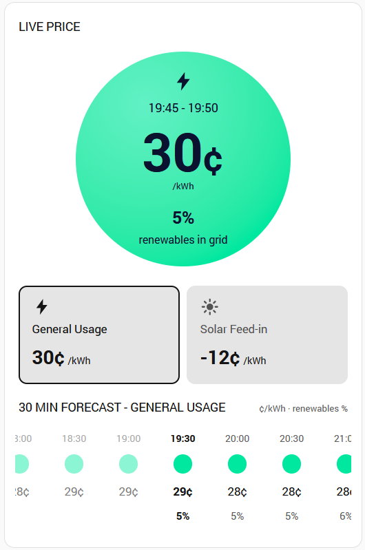

# Amber Forecast Card

A Home Assistant dashboard card that recreates the look of the Amber Electric web app / phone app price screen: a live price circle, a General / Solar toggle, and a scrollable 30-minute price forecast that expands into 5-minute intervals.



> Unofficial. This project is not affiliated with or endorsed by Amber Electric. "Amber" is their name and trademark.

## Features

- Live price circle, coloured by Amber's price descriptor, with the current interval and the % of renewables in the grid
- General usage and solar feed-in on one card, with a toggle that shows each channel's current price
- 30-minute forecast blocks showing price and renewables %. Tap a block to expand it into its 5-minute intervals, tap again to collapse
- Rolling window of past and future prices (24 hours each way by default). Past intervals are dimmed, and the strip opens centred on the current interval
- Uses theme colours from your dashboard

## Requirements

- Home Assistant with an Amber Electric account and API token
- The [Amber Express](https://github.com/hass-energy/amber-express) integration, which provides the forecast data this card reads. The card needs the `detailedForecast` attribute on its price sensors
- The recorder enabled (it is by default), because past prices come from Home Assistant's history

Support for the official Home Assistant Amber Electric integration is planned but not yet available.

## Installation

### HACS (custom repository)

1. In HACS, open the three-dot menu and choose **Custom repositories**.
2. Add `https://github.com/r5e/lovelace-amber-forecast-card` with the category **Dashboard**.
3. Find **Amber Forecast Card** in HACS and download it.
4. Reload your browser (hard refresh).

### Manual

1. Download `amber-forecast-card.js` from the latest release.
2. Copy it to `/config/www/`.
3. Go to **Settings > Dashboards > three-dot menu > Resources** and add `/local/amber-forecast-card.js` as a **JavaScript module**.
4. Hard refresh your browser.

## Usage

```yaml
type: custom:amber-forecast-card
general_entity: sensor.amber_express_home_general_price
feed_in_entity: sensor.amber_express_home_feed_in_price
```

Use the entity IDs of your own Amber Express price sensors. You can supply just one of the two entities if you only want one channel.

### Options

| Option | Default | Description |
| --- | --- | --- |
| `general_entity` | | Amber Express general price sensor |
| `feed_in_entity` | | Amber Express feed-in price sensor |
| `invert_feed_in` | `true` | Flip the sign of feed-in prices. Amber Express reports feed-in as negative when you are paid, so this is on by default |
| `hours` | `24` | Hours ahead to show |
| `past_hours` | `24` | Hours of history to show. `0` turns history off |
| `renewables_entity` | | Optional renewables % sensor. Fills in the renewables row for past intervals |
| `decimals` | `0` | Decimal places for cents. The Amber app shows whole cents |
| `show_live` | `true` | Show the live price circle |
| `expand_current` | `false` | Open the current 30-minute block in its 5-minute view on load |
| `show_renewables` | `true` | Show the renewables % row |

The older single-sensor form (`entity` plus `mode: feedin`) still works.

## Things to know

- **Matching the Amber app.** Per the Amber Express docs, its `per_kwh` pricing mode matches the forecasts the Amber app shows, while the default `advanced_price_predicted` mode is Amber's own prediction and will differ for future intervals. Change this in the Amber Express options if you want the card to match the app.
- **30-minute blocks are calculated.** The card averages the 5-minute intervals in each block, so a block can differ from the app by about 1 cent.
- **Past colours are estimated.** Home Assistant doesn't record historical price descriptors, so the card estimates past dot colours from the price ranges in the current forecast.
- **Past renewables** need `renewables_entity`. Without it the past renewables row is blank.
- **History depends on your recorder.** It only goes back as far as your recorder retention, and any time Home Assistant was off will show as a gap or a repeated price.
- The Amber app's summary text ("It's cheap to use energy right now!") is not reproduced.

## Troubleshooting

- **The card shows an old version or an old error after updating.** Your browser has cached the file. Change the resource URL to end in `?v=2` (and so on), reload with dev tools open and the cache disabled, or clear the frontend cache in the mobile app. The browser console prints the loaded version when the card loads.
- **"History unavailable" appears under the forecast heading.** The card couldn't read history for that sensor. Check that the entity is recorded and not excluded from the recorder.
- **No forecast data.** Check that the sensor has a `detailedForecast` attribute (Developer Tools > States) and that the Amber Express **Forecast intervals** option is set high enough.

## Credits

Forecast data comes from the [Amber Express](https://github.com/hass-energy/amber-express) integration and Amber's public API.

## License

MIT
